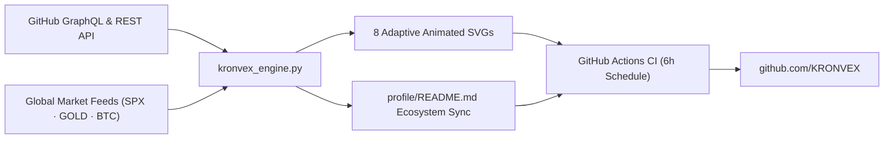

<p align="center">
  <a href="https://github.com/KRONVEX">
    <picture>
      <source media="(prefers-color-scheme: dark)" srcset="https://raw.githubusercontent.com/KRONVEX/.github/main/assets/hero_command_dark.svg">
      
    </picture>
  </a>
</p>

<h1 align="center">KRONVEX — Organization Control Plane (<code>.github</code>)</h1>

<p align="center">
  <i>Official profile architecture, automated SVG telemetry engine, and organization-wide engineering governance for <a href="https://github.com/KRONVEX"><b>KRONVEX</b></a>.</i>
</p>

<p align="center">
  <a href="https://github.com/KRONVEX/.github/actions/workflows/kronvex_telemetry.yml">
    
  </a>
  <a href="https://github.com/KRONVEX/.github/releases/latest">
    
  </a>
  <a href="https://github.com/KRONVEX">
    
  </a>
  
  
</p>

---

## Overview

This special **`.github`** repository serves as the central configuration and automation layer for the **[KRONVEX](https://github.com/KRONVEX)** GitHub organization:

> **Building cross-platform apps, market intelligence, and mission-critical AI to solve complex real-world problems.**

It powers three core capabilities across the entire organization:

1. **Public Organization Homepage (`profile/README.md`):** Automatically rendered by GitHub on [github.com/KRONVEX](https://github.com/KRONVEX) with full dark/light theme adaptation and live repository synchronization.
2. **Automated Telemetry & SVG Rendering Engine (`.github/scripts/kronvex_engine.py`):** A zero-fragility Python engine executed every 6 hours via GitHub Actions that aggregates live organization engineering metrics and global market feeds into custom animated SVG dashboards.
3. **Org-Wide Governance & Community Health Defaults:** Unified security disclosure, contribution guidelines, code of conduct, pull request checklists, and structured YAML issue forms automatically inherited by every repository under `KRONVEX`.

---

## Telemetry Pipeline Architecture



---

## Animated SVG Telemetry Modules

All visual panels share a unified **`960px` architectural grid**, native SMIL animations supported directly by GitHub, and automatic `prefers-color-scheme` dark/light rendering.

| Module | Assets (`assets/`) | Dimensions | Function & Data Source |
| :--- | :--- | :---: | :--- |
| **Command Header** | `hero_command_{dark,light}.svg` | `960 × 276` | Rotating orbital emblem, blueprint grid, scan pulse, mission lockup, and 3-pillar status strip. |
| **System Blueprint** | `architecture_pillars_{dark,light}.svg` | `960 × 326` | Three-pillar architectural matrix (*Cross-Platform*, *Market Intel*, *Mission-Critical AI*) with animated data conduits. |
| **Org Telemetry Console** | `org_telemetry_{dark,light}.svg` | `960 × 346` | Live GitHub GraphQL/REST KPIs, 16-week EMA velocity curve, stack matrix, and seamless *Genesis → Live* auto-transition. |
| **Global Signal Radar** | `intelligence_radar_{dark,light}.svg` | `960 × 206` | 360° animated tactical radar paired with live sparkline telemetry for `SPX`, `GOLD`, `BTC-USD`, and `KRONVEX` Org Pulse. |

---

## Repository Structure

```text
.github/
├── profile/
│   └── README.md                             # Public organization landing page (github.com/KRONVEX)
├── assets/
│   ├── hero_command_{dark,light}.svg         # Animated command center hero banner
│   ├── architecture_pillars_{dark,light}.svg # Three-pillar system architecture blueprint
│   ├── org_telemetry_{dark,light}.svg        # Live organization engineering console
│   └── intelligence_radar_{dark,light}.svg   # Global market & signal radar HUD
├── .github/
│   ├── scripts/kronvex_engine.py             # Telemetry fetcher, SVG renderer & README sync engine
│   └── workflows/kronvex_telemetry.yml       # Scheduled 6h CI/CD automation workflow
├── ISSUE_TEMPLATE/
│   ├── bug_report.yml                        # Structured org-wide bug report form
│   ├── feature_request.yml                   # Architecture & feature proposal form
│   └── config.yml                            # Issue chooser & security redirect links
├── PULL_REQUEST_TEMPLATE.md                  # Standard PR verification checklist
├── SECURITY.md                               # Responsible vulnerability disclosure policy
├── CONTRIBUTING.md                           # Engineering standards & contribution workflow
├── CODE_OF_CONDUCT.md                        # Community conduct standards
└── README.md                                 # Control plane documentation (this file)
```

---

## Org-Wide Governance Defaults

Every new repository created under **[KRONVEX](https://github.com/KRONVEX)** automatically inherits the following standards unless overridden locally:

| Standard | Document | Purpose |
| :--- | :--- | :--- |
| **Security Policy** | [SECURITY.md](SECURITY.md) | Private vulnerability disclosure channels and 48h/5d response SLAs. |
| **Contribution Guide** | [CONTRIBUTING.md](CONTRIBUTING.md) | Branching, conventional commits, reliability standards, and review criteria. |
| **Code of Conduct** | [CODE_OF_CONDUCT.md](CODE_OF_CONDUCT.md) | Professional collaboration expectations across all org repositories. |
| **Issue & PR Templates** | [ISSUE_TEMPLATE/](ISSUE_TEMPLATE) · [PULL_REQUEST_TEMPLATE.md](PULL_REQUEST_TEMPLATE.md) | Structured defect reports, pillar-tagged proposals, and PR verification checklists. |

---

## Engine CLI & CI Configuration

The rendering engine in [`.github/scripts/kronvex_engine.py`](.github/scripts/kronvex_engine.py) uses the Python standard library (with optional `yfinance` for real-time market series) and protects existing live SVGs from being overwritten during transient upstream outages.

### CLI Usage

```bash
# Regenerate assets with live GitHub API & global market telemetry
python .github/scripts/kronvex_engine.py --org KRONVEX --force

# Offline local preview (Genesis / Standby baseline, zero network calls)
python .github/scripts/kronvex_engine.py --offline --force
```

### Arguments & Environment Variables

| Option / Variable | Default | Description |
| :--- | :--- | :--- |
| `--org` / `ORG_NAME` | `KRONVEX` | Target GitHub organization login queried for telemetry and ecosystem sync. |
| `--assets-dir` | `assets` | Output directory for all 8 generated dark/light SVG panels. |
| `--readme` | `profile/README.md` | Target organization README containing `<!-- ORG-REPOS:START/END -->` sync markers. |
| `--offline` | `false` | Runs deterministic local generation without network requests. |
| `--force` | `false` | Forces overwriting existing SVGs even when running in offline/standby mode. |
| `ORG_ACCESS_TOKEN` | *(optional secret)* | Fine-grained PAT (read-only org repos/metadata) for full GraphQL commit history. Falls back automatically to `GITHUB_TOKEN` and REST API. |

---

## Maintainer & Leadership

Maintained by **[@khalid-naami](https://github.com/khalid-naami)** — Founder & Lead Architect of **[KRONVEX](https://github.com/KRONVEX)**.

* **Organization:** [github.com/KRONVEX](https://github.com/KRONVEX) · [kronvex1@gmail.com](mailto:kronvex1@gmail.com)
* **Web & Research:** [khalidnaami.com](https://khalidnaami.com) · [research@khalidnaami.com](mailto:research@khalidnaami.com)
